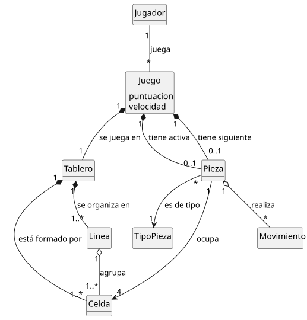
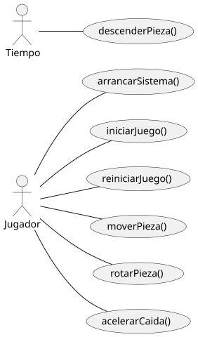
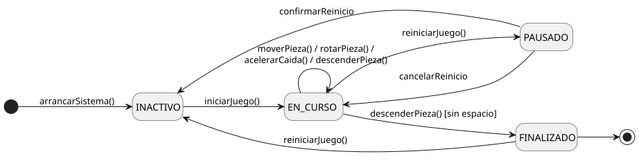
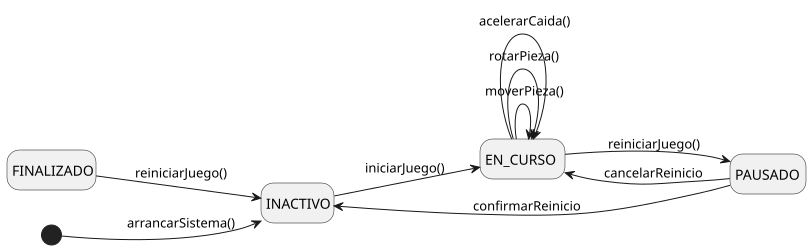
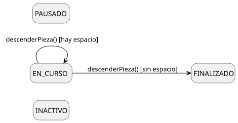
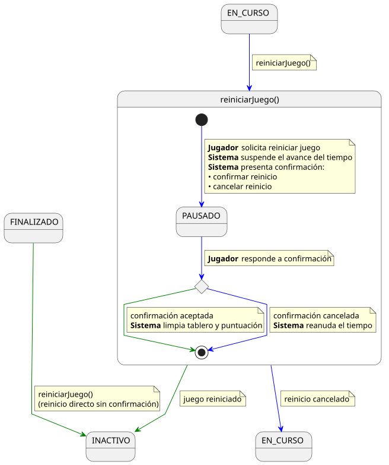
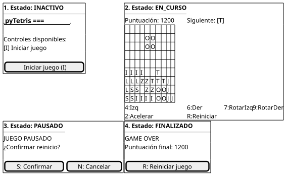

# Reto 002 · Revisión del ejemplo de Tetris

**Diego Alonso Díaz · Ingeniería del Software I**

[Volver al repositorio](../README.md)

## Documentación

- [Análisis del ejemplo](alonsoDiego/documentos/analisis.md): incoherencias detectadas y decisiones discutibles sobre el repositorio `pyTetris`.
- [Propuesta de mejora](alonsoDiego/documentos/propuesta.md): correcciones del modelo del dominio, vocabulario de casos de uso, máquina de estados y prototipo.

## Índice de artefactos UML

| Diagrama | Imagen | Código editable |
| :--- | :--- | :--- |
| Modelo del dominio | [ModeloDominio.svg](alonsoDiego/imagenes/ModeloDominio.svg) | [ModeloDominio.puml](alonsoDiego/modelosUML/ModeloDominio.puml) |
| Casos de uso | [DiagramaCasosUso.svg](alonsoDiego/imagenes/DiagramaCasosUso.svg) | [DiagramaCasosUso.puml](alonsoDiego/modelosUML/DiagramaCasosUso.puml) |
| Estados del sistema (Contexto 000) | [DiagramaDeContexto000.svg](alonsoDiego/imagenes/DiagramaDeContexto000.svg) | [DiagramaDeContexto000.puml](alonsoDiego/modelosUML/DiagramaDeContexto000.puml) |
| Contexto · Actor `Jugador` | [DiagramaDeContexto001-ActorJugador.svg](alonsoDiego/imagenes/DiagramaDeContexto001-ActorJugador.svg) | [DiagramaDeContexto001-ActorJugador.puml](alonsoDiego/modelosUML/DiagramaDeContexto001-ActorJugador.puml) |
| Contexto · Actor `Tiempo` | [DiagramaDeContexto001-ActorTiempo.svg](alonsoDiego/imagenes/DiagramaDeContexto001-ActorTiempo.svg) | [DiagramaDeContexto001-ActorTiempo.puml](alonsoDiego/modelosUML/DiagramaDeContexto001-ActorTiempo.puml) |
| Detalle · `reiniciarJuego()` | [reiniciarJuego.svg](alonsoDiego/imagenes/reiniciarJuego.svg) | [reiniciarJuego.puml](alonsoDiego/modelosUML/reiniciarJuego.puml) |
| Prototipo de interfaz corregido | [prototipoCorregido.svg](alonsoDiego/imagenes/prototipoCorregido.svg) | [prototipoCorregido.puml](alonsoDiego/modelosUML/prototipoCorregido.puml) |

---

## Visualización de diagramas

### Modelo del dominio

[Ver código PlantUML](alonsoDiego/modelosUML/ModeloDominio.puml)

### Diagrama de casos de uso

[Ver código PlantUML](alonsoDiego/modelosUML/DiagramaCasosUso.puml)

### Estados del sistema (Contexto 000)

[Ver código PlantUML](alonsoDiego/modelosUML/DiagramaDeContexto000.puml)

### Contexto · Actor `Jugador`

[Ver código PlantUML](alonsoDiego/modelosUML/DiagramaDeContexto001-ActorJugador.puml)

### Contexto · Actor `Tiempo`

[Ver código PlantUML](alonsoDiego/modelosUML/DiagramaDeContexto001-ActorTiempo.puml)

### Detalle · `reiniciarJuego()`

[Ver código PlantUML](alonsoDiego/modelosUML/reiniciarJuego.puml)

### Prototipo de interfaz corregido

[Ver código PlantUML](alonsoDiego/modelosUML/prototipoCorregido.puml)
