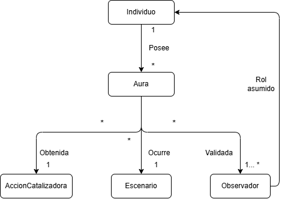

1. Diagrama de Clases

2. Glosario:

-Individuo: Entidad que participa en un evento.

-RegistroAura: La constancia de un evento específico que alteró el estatus social del individuo

-AccionCatalizadora: El catálogo que define el acto cometido y su valor base.

-Escenario: El entorno físico o digital donde ocurre la acción, definiendo su nivel de exposición pública.

-Observador: Testigo presencial necesario para que el evento tenga validez.

3. Supuestos Adoptados:

-Validación de Puntaje: El aura requiere validación de terceros. Un evento sin observadores tiene un valor nulo debido a que no se puede validar.

-Penalizaciones: Si se determina que la acción fue forzada, el impacto positivo se reduce drásticamente o se invierte

-Sistema de Rangos: Los puntos de aura acumulados determinan la posición del individuo en una jerarquía de estatus. Esta posición se recalcula tras cada evento.

4. Justificacion de Decisiones de Modelado

-Separación de AccionCatalizadora: Funciona como un manual de reglas independiente. Si las normas sociales cambian y se requiere ajustar el valor de una acción, solo se actualiza este catálogo. Esto evita alterar los historiales que los individuos ya consolidaron en el pasado.

-Herencia de Observador sobre Individuo: La credibilidad de un testigo se calcula en función de su propio estatus social. Obtener la validación de alguien con alto prestigio multiplica la ganancia. Además, heredar el concepto permite identificar qué personas exactas validaron cada evento.

-multiplicadorEntorno en Escenario: En lugar de que el registro del evento concentre toda la responsabilidad de evaluar el contexto, se delegó la tarea de analizar el entorno físico/digital al propio concepto de Escenario, logrando un modelo más ordenado