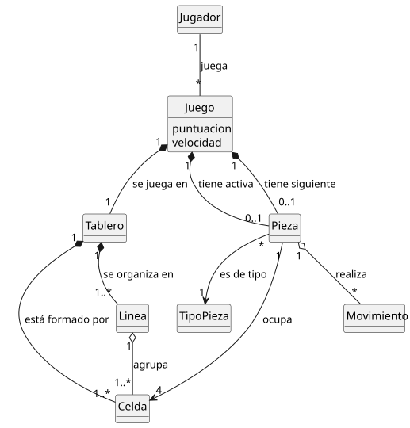
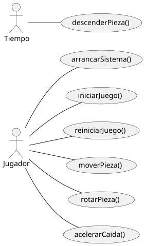
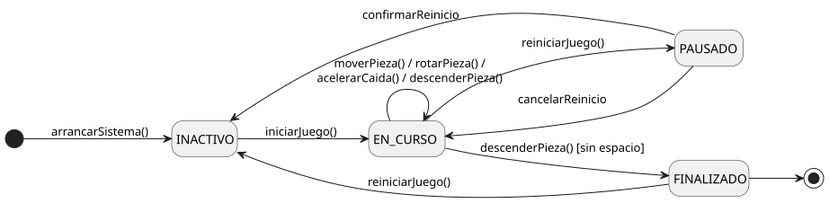
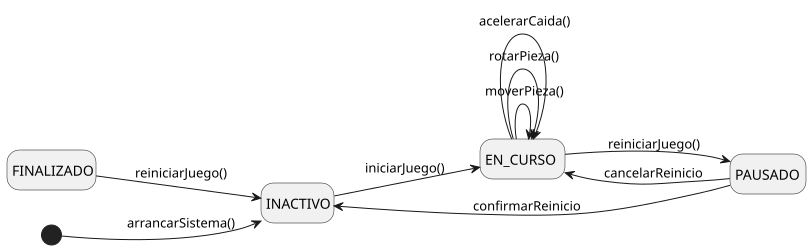
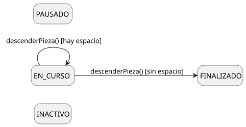
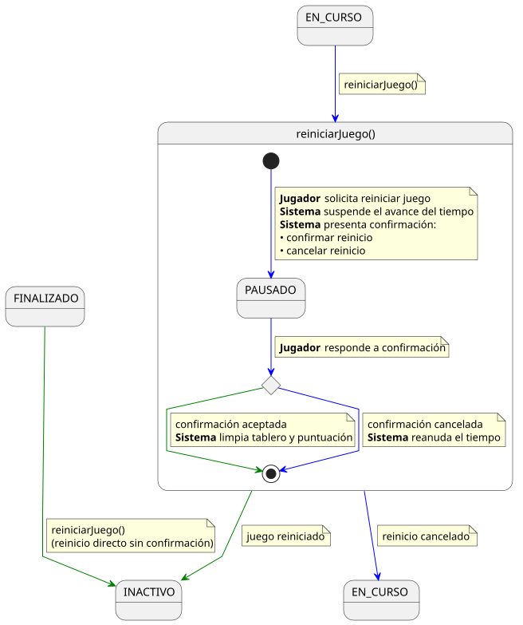
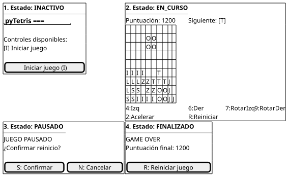

# Propuesta de mejora para `pyTetris`

[Volver al README](../README.md) · [Ver el análisis](analisis.md)

[Modelo del dominio](#1-modelo-del-dominio-corregido) · [Casos de uso y vocabulario](#2-catálogo-de-casos-de-uso-y-vocabulario) · [Estados y contexto](#3-máquina-de-estados-y-diagramas-de-contexto) · [Prototipo de interfaz](#4-corrección-del-prototipo-de-interfaz)

Esta propuesta recoge las correcciones estructurales, terminológicas y de comportamiento derivadas de las incoherencias y decisiones discutibles identificadas en el [análisis](analisis.md).

---

## 1. Modelo del dominio corregido

[Abrir diagrama](../imagenes/ModeloDominio.svg) · [Ver PlantUML](../modelosUML/ModeloDominio.puml)

Para garantizar la consistencia entre la documentación textual y el diagrama UML, y corregir los problemas de modelado detectados, se aplican los siguientes cambios:

* **Eliminación de `Turno`:** Al tratarse de un sistema reactivo en tiempo real y no de un juego por turnos, se suprime la entidad `Turno` y se asocia `Movimiento` directamente con `Pieza`.
* **Composición estricta entre `Juego` y `Pieza`:** Se sustituye la agregación (`Juego o-- Pieza`) por composición (`Juego *-- Pieza`), ya que los arquetipos independientes pertenecen a `TipoPieza`, mientras que cada instancia concreta de pieza en curso depende del ciclo de vida del `Juego`.
* **Eliminación de la doble composición sobre `Celda`:** `Tablero` mantiene la propiedad exclusiva por composición sobre sus celdas (`Tablero *-- Celda`), mientras que `Linea` pasa a relacionarse con `Celda` mediante agregación lógica (`Linea o-- Celda`) para evitar dos propietarios simultáneos.
* **Incorporación de `Jugador` y pieza siguiente:** Se añade `Jugador` (`Jugador 1 -- * Juego`) para asegurar trazabilidad directa con los requisitos y soportar futuras estadísticas, y se diferencia en `Juego` la pieza activa respecto a la siguiente pieza en cola (`PiezaSiguiente`).
* **Atributos y multiplicidades explícitas:** Se reflejan en el diagrama todas las multiplicidades (`1:1`, `1:*`, `*:1`) y propiedades discutidas en el texto (`puntuacion` y `velocidad` en `Juego`).

---

## 2. Catálogo de casos de uso y vocabulario

[Abrir diagrama](../imagenes/DiagramaCasosUso.svg) · [Ver PlantUML](../modelosUML/DiagramaCasosUso.puml)

* **Unificación terminológica (`Juego` en lugar de `Partida`):** Respetando la depuración de sinónimos del modelo del dominio, los casos de uso `iniciarPartida()` y `reiniciarPartida()` pasan a denominarse **`iniciarJuego()`** y **`reiniciarJuego()`**, propagando el cambio a todos los diagramas de detalle y notas.
* **Rediseño del control de caída:** Se elimina el archivo huérfano `acelerarCaida.svg` y se sustituye el interruptor binario `alternarVelocidadCaida()` por **`acelerarCaida()`** (descenso rápido puntual o *soft drop*), permitiendo recuperar el control fino de forma inmediata sin tener que conmutar modos.
* **Delimitación de `arrancarSistema()`:** Se elimina de su detalle interno la lista de operaciones disponibles tras el arranque (`iniciarJuego()`), ya que dichas acciones corresponden al estado destino `INACTIVO` y no a la transición de inicio.

---

## 3. Máquina de estados y diagramas de contexto

Para resolver las contradicciones entre las vistas de contexto y los diagramas de detalle de casos de uso, se establecen tres reglas:

1. **Nomenclatura única:** Todos los diagramas emplean exclusivamente los identificadores en mayúsculas **`INACTIVO`**, **`EN_CURSO`**, **`PAUSADO`** y **`FINALIZADO`**.
2. **Aislamiento estricto por actor:**
   * En el contexto del **`Jugador`**, se elimina la transición sin etiqueta hacia `FINALIZADO` (ya que el jugador no provoca el fin de partida) y se añaden sus transiciones reales de control y reinicio.
   * En el contexto del **`Tiempo`**, se eliminan las transiciones de arranque, inicio y reinicio (`[*] -> INACTIVO`, `INACTIVO --> EN_CURSO`, `FINALIZADO --> INACTIVO`), dejando únicamente `descenderPieza()` sobre `EN_CURSO` (con permanencia en `EN_CURSO` o paso a `FINALIZADO` cuando no hay espacio para una nueva pieza).
3. **Gestión segura de `reiniciarJuego()` mediante estado `PAUSADO`:**
   * Desde `FINALIZADO`, `reiniciarJuego()` transita directamente a `INACTIVO` sin confirmación innecesaria.
   * Desde `EN_CURSO`, `reiniciarJuego()` lleva el sistema a **`PAUSADO`** mientras muestra el diálogo de confirmación, suspendiendo la actuación del actor `Tiempo` para evitar que las piezas sigan cayendo mientras el jugador decide. Si confirma, pasa a `INACTIVO`; si cancela, regresa a `EN_CURSO` conservando intacto el estado de la partida.

| Vista | Diagrama | Código fuente |
| :--- | :--- | :--- |
| **Estados generales del sistema** |  | [DiagramaDeContexto000.puml](../modelosUML/DiagramaDeContexto000.puml) |
| **Contexto: Actor `Jugador`** |  | [DiagramaDeContexto001-ActorJugador.puml](../modelosUML/DiagramaDeContexto001-ActorJugador.puml) |
| **Contexto: Actor `Tiempo`** |  | [DiagramaDeContexto001-ActorTiempo.puml](../modelosUML/DiagramaDeContexto001-ActorTiempo.puml) |
| **Detalle: `reiniciarJuego()`** |  | [reiniciarJuego.puml](../modelosUML/reiniciarJuego.puml) |

---

## 4. Corrección del prototipo de interfaz

* **Geometría válida en el tablero:** Se reemplazan las agrupaciones imposibles del prototipo original (bloques compactos de `3×4` celdas `I` y `4×2` celdas `L`) por combinaciones válidas de tetrominós de 4 bloques conectadas según los 7 tipos definidos en el dominio.
* **Soporte completo de interacción y estados:**
  * En la pantalla **`EN_CURSO`** se incorporan la visualización de la siguiente pieza (`Siguiente`), los comandos faltantes para acelerar la caída (`2=bajar`) y solicitar reinicio (`R=reiniciar`), junto a los controles existentes (`4=izq`, `6=der`, `7=rotar↺`, `9=rotar↻`).
  * Se añaden los bocetos de interfaz para los estados **`INACTIVO`** (pantalla inicial con opción de iniciar juego), **`PAUSADO`** (mensaje de confirmación de reinicio con opciones de confirmar o cancelar) y **`FINALIZADO`** (resumen de puntuación final y opción de reinicio directo).