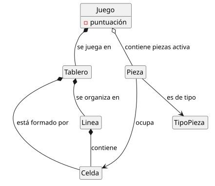
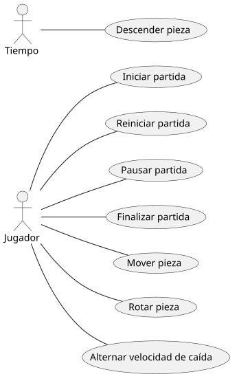
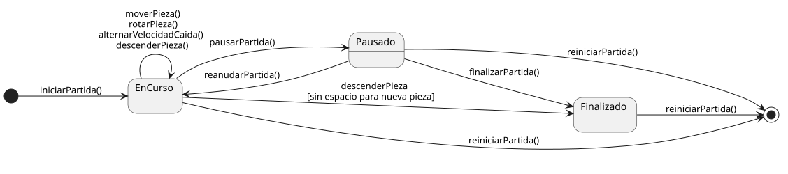
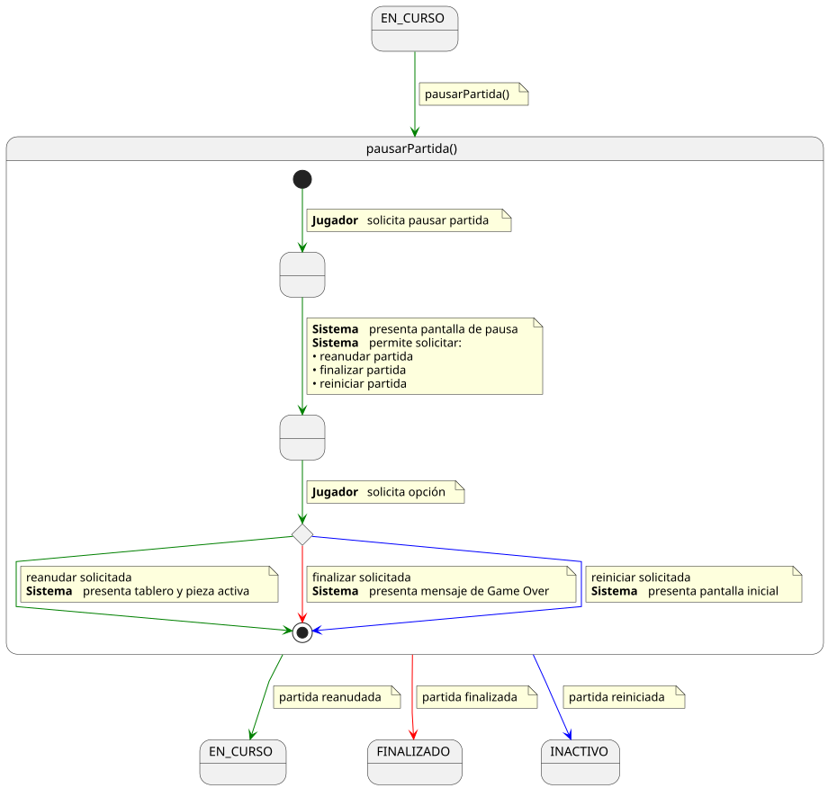

# Entrega 002 - Tetris: Incoherencias y Decisiones Discutibles

---

## Modelos Propuestos

A continuación se presentan los diagramas corregidos y propuestos que dan respuesta a las incoherencias detectadas y a las decisiones discutibles abordadas en esta entrega:

### 1. Modelo del Dominio Propuesto

Código fuente: [`modelosUML/ModeloDominioPropuesto.puml`](modelosUML/ModeloDominioPropuesto.puml)

### 2. Diagrama de Casos de Uso Propuesto

Código fuente: [`modelosUML/DiagramaCasosUsoPropuesto.puml`](modelosUML/DiagramaCasosUsoPropuesto.puml)

### 3. Diagrama de Estados Propuesto

Código fuente: [`modelosUML/DiagramaEstadosPropuesto.puml`](modelosUML/DiagramaEstadosPropuesto.puml)

### 4. Detalle del Caso de Uso: Pausar Partida

Código fuente: [`modelosUML/detalleCasosUso/pausarPartida.puml`](modelosUML/detalleCasosUso/pausarPartida.puml)

---

## Referencias

* [**Modelo del dominio**](https://github.com/puntoReflex/pyTetris/blob/main/docs/modeloDelDominio.md)

* [**Disciplina de requisitos**](https://github.com/puntoReflex/pyTetris/blob/main/docs/ProcesoRequisitos.md) (actores, casos de uso, diagramas de contexto, especificación detallada y prototipo).

¿Qué se analizará?

1. **Incoherencias:** Detección de artefactos o partes de estos que entran en contradicción directa al describir un mismo concepto, regla o comportamiento. Para cada hallazgo se identifica su ubicación, la discrepancia entre fuentes, cuál versión debe corregirse y su justificación técnica.
2. **Decisiones discutibles:** Identificación de decisiones de modelado o diseño que, aun siendo consistentes con el resto de documentos, resultan subóptimas o cuestionables. Para cada una se detalla qué se decidió, la propuesta alternativa y la argumentación formal.

---

## Hallazgos

| # | Incoherencias | Decisiones discutibles |
| :-: | :--- | :--- |
| **1** | **[Relación `Pieza - Celda` omitida en la tabla](incoherencias.md#incoherencia-1-relación-pieza---celda-omitida-en-la-tabla-de-relaciones-pero-graficada-en-el-uml)** Identificada como relación natural en la Sección 5 y dibujada en el diagrama UML final (`Pieza --> Celda`), pero totalmente ausente en la tabla de refinamiento y multiplicidades (Sección 7). | **[Modelar la entidad `Turno` en tiempo real](decisionesDiscutibles.md#decisión-1-modelar-la-entidad-turno-en-un-juego-en-tiempo-real)** Forzar un concepto de juegos discretos o por turnos en un arcade continuo asíncrono, introduciendo una clase sin ciclo de vida real en el dominio. |
| **2** | **[Puntuación descartada vs. requerida](incoherencias.md#incoherencia-2-puntuación-descartada-en-el-dominio-vs-requerida-en-requisitos-y-prototipo)** Descartada formalmente en el modelo del dominio (Sección 6.2 y tabla de descartados), pero calculada, acumulada y presentada en todos los casos de uso y en el prototipo (`Score: 0`). | **[Ausencia del Caso de Uso `Pausar partida`](decisionesDiscutibles.md#decisión-2-ausencia-del-caso-de-uso-de-pausar-partida)** Omisión de la pausa como caso de uso a pesar de haberse identificado el verbo *"pausar"* en el análisis de responsabilidades del juego y ser una necesidad básica del jugador en tiempo real. |
| **3** | **[El estado `Inactivo` y la transición inicial](incoherencias.md#incoherencia-3-el-estado-inactivo-y-la-transición-inicial-estados-del-sistema-vs-estados-de-la-partida)** Contradicción sobre el origen de `Inactivo` (`[*]` espontáneo vs. disparado por `arrancarSistema()`) y solapamiento entre el ciclo de vida del software y el de la partida (principio de inexistencia). | **[Modelar `Movimiento` como clase conceptual](decisionesDiscutibles.md#decisión-3-modelar-movimiento-como-clase-conceptual-en-el-modelo-del-dominio)** Cosificación de métodos al tratar una transformación geométrica instantánea (verbo) como una clase persistente con relaciones, inflando el modelo con entidades vacías. |

---

* 📄 **[Incoherencias Detalladas](incoherencias.md)**
* 📄 **[Decisiones Discutibles Detalladas](decisionesDiscutibles.md)**
