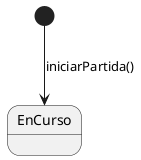

# Incoherencias Detectadas en pyTetris

De acuerdo con las instrucciones de [reto002.md](https://github.com/puntoReflex/26-27-idsw1/blob/main/evaluaciones/retos/reto002.md), una **incoherencia** es:

> *"Artefactos que dicen cosas distintas sobre lo mismo. Para cada una: dónde están, qué dicen cada uno, cuál corregirían y por qué. Un hallazgo sin los puntos citados no cuenta como incoherencia."*

---

## Incoherencia 1: Relación `Pieza - Celda` omitida en la tabla de relaciones pero incluida en el diagrama de clases

### 1. Dónde están
* **Artefacto A:** [`docs/modeloDelDominio.md`](https://github.com/puntoReflex/pyTetris/blob/main/docs/modeloDelDominio.md#7-refinamiento-de-relaciones): **Sección 7** (*Refinamiento de relaciones: Análisis de multiplicidades y tipos*).
* **Artefacto B:** [`docs/modeloDelDominio.md`](https://github.com/puntoReflex/pyTetris/blob/main/docs/modeloDelDominio.md#8-modelo-del-dominio-resultante): **Sección 8** (*Modelo del dominio resultante*) y su archivo fuente [`modelosUML/ModeloDominio.puml`](https://github.com/puntoReflex/pyTetris/blob/main/modelosUML/ModeloDominio.puml).

### 2. Qué dice cada uno
* En la **Sección 5** se enuncia explícitamente como una de las relaciones evidentes:
  > *"Las **piezas** ocupan **celdas**"*
* Sin embargo, en la **tabla de la Sección 7**, donde se supone que se analizan y justifican los tipos de relación y multiplicidades de todos los conceptos identificados, la relación `Pieza - Celda` **desaparece**. La tabla únicamente lista 6 relaciones:

  1. `Juego - Tablero`
  2. `Juego - Pieza (activas)`
  3. `Tablero - Celda`
  4. `Tablero - Línea`
  5. `Pieza - TipoPieza`
  6. `Línea - Celda`

* A pesar de haber sido omitida en el análisis formal de la Sección 7, en el **diagrama UML final de la Sección 8** (`ModeloDominio.puml`) la relación reaparece dibujada:

  ```plantuml
  Pieza --> Celda : "ocupa"
  ```

### 3. Cuál corregiría
Corregir la tabla de la **Sección 7 de `modeloDelDominio.md`**, añadiendo formalmente la fila correspondiente a `Pieza - Celda`.

### 4. Por qué
La tabla de la Sección 7 es el paso prevío para la construcción del diagrama. Dejar relaciones ambiguas que saltan de la lista de ideas preliminares directamente al diagrama UML sin pasar por el análisis de multiplicidades rompe la trazabilidad interna del documento. Además, al omitirla en la tabla se deja sin especificar su cardinalidad exacta: en el Tetris cada pieza ocupa exactamente cuatro celdas (`1:*`), un dato crucial que el diseño y la implementación necesitan conocer.

---

## Incoherencia 2: `Puntuación` descartada en el Dominio vs. requerida en Requisitos y Prototipo

### 1. Dónde están
* **Artefacto A:** [`docs/modeloDelDominio.md`](https://github.com/puntoReflex/pyTetris/blob/main/docs/modeloDelDominio.md#puntuación-y-nivel-como-entidades): **Sección 6.2** (*¿"Puntuación" y "Nivel" como entidades?*) y tabla de *Conceptos descartados en el proceso*.
* **Artefacto B:** [`docs/ProcesoRequisitos.md`](https://github.com/puntoReflex/pyTetris/blob/main/docs/ProcesoRequisitos.md) &rarr; Diagramas de detalle de casos de uso (`iniciarPartida.puml`, `descenderPieza.puml`) y prototipo gráfico ([`images/tetris.png`](https://github.com/puntoReflex/pyTetris/blob/main/images/tetris.png)).

### 2. Qué dice cada uno
* En **`modeloDelDominio.md`** se decide explícitamente descartar la puntuación:
  > *"¿'Puntuación' y 'Nivel' como entidades? (...) Decisión: excluir como entidades - Son propiedades de Juego"*
  
  Sin embargo, en el diagrama UML de la Sección 8 (`ModeloDominio.puml`), `Juego` **no posee ningún atributo ni relación** de puntuación; se suprimió por completo cualquier rastro de la misma en el modelo conceptual.
* En **`ProcesoRequisitos.md`**, la puntuación es un requisito funcional activo en los flujos principales:
  * En `iniciarPartida()`: *"Sistema presenta puntuación inicial (0)"*.
  * En `descenderPieza()`: *"Sistema presenta puntuación actualizada"* (al completarse y eliminarse líneas).
  * En el prototipo: Se muestra de manera fija el rótulo `Score: 0` al pie del tablero.

### 3. Corrección
Corregir el **modelo del dominio** (`modeloDelDominio.md` y `ModeloDominio.puml`) para incluir el atributo `puntuación` dentro de la clase conceptual `Juego`.

### 4. Por qué
El temario de la asignatura sobre corrección semántica ([`mddCorreccionSemantica.md`](https://github.com/mmasias/IdSw1/blob/main/temario/contenidos/ejemplos/mdd/mddCorreccionSemantica.md#L26)) exige contrastar continuamente el modelo del dominio con los documentos de requisitos para verificar que el modelo contenga la información necesaria para soportar los casos de uso. Si los requisitos especifican que el sistema calcula, incrementa y visualiza puntos como recompensa por eliminar líneas, la puntuación es una regla de información del juego y no puede ser omitida del contrato conceptual.

> En mi [Modelo del Dominio propuesto](modelosUML/ModeloDominioPropuesto.puml) ([ver SVG](images/ModeloDominioPropuesto.svg)) se modela la puntuación como atributo de `Juego`:
> ```plantuml
> class Juego {
>   - puntuación
> }
> ```

Aunque pueda que en esta fase aún no se incluyan los atributos pero es importante mencionarlo ya que en la teoría de la asignatura forma parte de la creación del modelo.

---

## Incoherencia 3: El estado `Inactivo` y la transición inicial

### 1. Dónde están
* **Artefacto A:** [`modelosUML/DiagramaDeContexto000.puml`](https://github.com/puntoReflex/pyTetris/blob/main/modelosUML/DiagramaDeContexto000.puml) (Diagrama de estados general del sistema).
* **Artefacto B:** [`modelosUML/DiagramaDeContexto001-ActorJugador.puml`](https://github.com/puntoReflex/pyTetris/blob/main/modelosUML/DiagramaDeContexto001-ActorJugador.puml) y los diagramas de detalle [`detalleCasosUso/arrancarSistema.puml`](https://github.com/puntoReflex/pyTetris/blob/main/modelosUML/detalleCasosUso/arrancarSistema.puml) e [`iniciarPartida.puml`](https://github.com/puntoReflex/pyTetris/blob/main/modelosUML/detalleCasosUso/iniciarPartida.puml).

### 2. Qué dice cada uno

* En **`DiagramaDeContexto000.puml`**, el estado `Inactivo` se alcanza mediante una transición inicial espontánea sin evento disparador:

  ```plantuml
  @startuml
  [*] -> Inactivo
  @enduml
  ```

* En **`DiagramaDeContexto001-ActorJugador.puml`** y **`arrancarSistema.puml`**, el estado `Inactivo` no surge espontáneamente, sino que requiere la invocación explícita del caso de uso por parte del actor:

  ```plantuml
  @startuml
  [*] -> Inactivo : arrancarSistema()
  @enduml
  ```

  y su postcondición en la nota es *"sistema disponible"*.
* Para agravar la inconsistencia, en **`iniciarPartida.puml`** y **`reiniciarPartida.puml`**, el estado `Inactivo` se redefine conceptualmente no como "sistema listo", sino como **"partida aún no creada o reiniciada"**.

### 3. Corrección

Corregir los diagramas de contexto y de detalle para **separar el ciclo de vida de la Aplicación del ciclo de vida de la Partida**, eliminando el estado artificial `Inactivo` de la partida. La partida debe transicionar directamente desde su creación con el caso de uso `iniciarPartida()`:


### 4. Por qué
Este hallazgo presenta dos problemas graves:
1. Un diagrama afirma que el sistema nace espontáneamente en `Inactivo`, mientras que el otro afirma que requiere la ejecución obligatoria del caso de uso `arrancarSistema()`.
2. Se confunden los estados de la aplicación de software con los estados del juego en curso. Siguiendo la conversación sobre modelado en este [PR](https://github.com/mmasias/26-27-idsw1/pull/44): **un objeto no puede hallarse en un estado antes de existir**. Una partida de Tetris no está *"inactiva"* antes de jugarse; sencillamente **no existe**. Cuando el usuario arranca la aplicación, el software pasa a estar `Disponible` o en el menú; cuando decide jugar, nace la partida (`[*] -> EnCurso`). Tratar `Inactivo` como un estado de la partida antes de que esta empiece equivale a atribuirle un estado a algo inexistente.

> En nuestro [Diagrama de Estados propuesto](modelosUML/DiagramaEstadosPropuesto.puml) ([ver SVG](images/DiagramaEstadosPropuesto.svg)) se modela el ciclo de vida riguroso de la partida, comenzando en `[*] --> EnCurso : iniciarPartida()` e integrando el estado `Pausado`.
