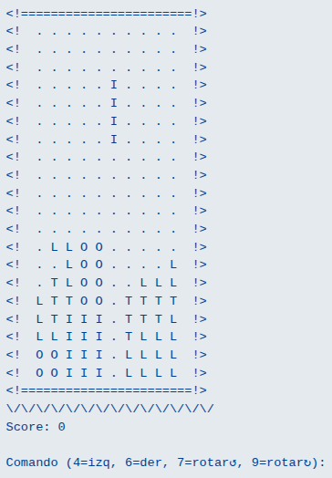

# Fuentes e inventario

[Presentación](../README.md) · [Método](metodo.md) · [Incoherencias](incoherencias.md) · [Decisiones discutibles](decisiones-discutibles.md)

## Versión revisada

Repositorio **puntoReflex/pyTetris**, rama de consulta `main`, commit **92c950ad9746dc768be130f75c988c0f712d5509**. Consulta: **17/11/2026**. Se usan enlaces permanentes a ese commit. Los identificadores siguientes permiten localizar cada evidencia; dentro de cada hallazgo se precisa el apartado o la transición.

| ID | Artefacto revisado | Qué se contrasta |
|---|---|---|
| MD | [Modelo del dominio: texto completo][MD] | Observaciones, tablas, decisiones, simplificaciones, evolución y validación |
| DOM | [Fuente del modelo resultante][DOM] | Entidades, asociaciones y composiciones |
| REQ | [Proceso de requisitos: texto completo][REQ] | Actores, catálogo y explicación del prototipo |
| CU | [Diagrama de casos de uso][CU] | Dos actores y siete casos de uso |
| EST | [Estados globales][EST] | Transiciones admitidas por el sistema |
| JUG | [Contexto del jugador][JUG] | Inicio, manipulación y reinicio |
| TMP | [Contexto del tiempo][TMP] | Descenso y terminación |
| ARR | [Detalle de arrancarSistema][ARR] | Entrada al sistema y pantalla inicial |
| INI | [Detalle de iniciarPartida][INI] | Estado inicial de una partida y acciones disponibles |
| MOV | [Detalle de moverPieza][MOV] | Movimiento válido y bloqueado |
| ROT | [Detalle de rotarPieza][ROT] | Rotación válida y bloqueada |
| VEL | [Detalle de alternarVelocidadCaida][VEL] | Dos sentidos del cambio de velocidad |
| DES | [Detalle de descenderPieza][DES] | Descenso, fijación, líneas, puntos y fin de partida |
| REI | [Detalle de reiniciarPartida][REI] | Confirmación, cancelación y destinos |
| IMG | [Prototipo original][IMG] | Tablero, puntuación y leyenda de controles |

Para cada fuente `.puml` se revisó también el SVG publicado en `images/modelosUML/`, con el mismo nombre y subcarpeta. Las fuentes enlazadas sirven para localizar el contenido; los SVG son los artefactos que ve el lector de las páginas. No se encontró una discrepancia de contenido entre esas fuentes y sus imágenes en los puntos examinados.

## Prototipo inspeccionado

Copia sin modificaciones de [images/tetris.png][IMG], procedente del commit revisado de `puntoReflex/pyTetris` ([licencia Unlicense](https://github.com/puntoReflex/pyTetris/blob/92c950ad9746dc768be130f75c988c0f712d5509/LICENSE)). Es una captura del prototipo, no un diagrama PlantUML. Los diagramas propios de esta entrega se exportan exclusivamente a **SVG**.

La captura permite observar una pieza vertical en la zona superior, piezas fijadas en la parte inferior, `Score: 0` y la leyenda `4=izq, 6=der, 7=rotar↺, 9=rotar↻`. No permite medir la velocidad, observar una secuencia temporal ni conocer las interacciones que no aparecen en ella.

## Apoyo docente y normativo

- [Modelo del dominio, idsw1](https://github.com/mmasias/idsw1/blob/main/temario/contenidos/00004-MdD.md): conceptos, asociaciones, atributos y revisión de consistencia.
- [Encontrar actores y casos de uso, idsw1](https://github.com/mmasias/idsw1/blob/main/temario/contenidos/00006-CdU.eAyCdU.md): admite al actor Tiempo y pide describir el modelo como un todo.
- [Detallar casos de uso, idsw1](https://github.com/mmasias/idsw1/blob/main/temario/contenidos/00008-Cdu.dCdU.md): flujos alternativos, contratos y lenguaje de interacción.
- [Prototipar casos de uso, idsw1](https://github.com/mmasias/idsw1/blob/main/temario/contenidos/00009-CdU.ICdU.md): bocetos para validar la interacción.
- [Modelo del dominio de hdC](https://github.com/mmasias/hdC/blob/main/docs/UMLdocs/mdd.md): organización de vistas complementarias.
- [UML 2.5.1, OMG, §9.5.3, p. 112](https://www.omg.org/spec/UML/2.5.1/PDF): una parte no puede pertenecer simultáneamente a dos propietarios por composición. Se utiliza únicamente para justificar D01.

Los enlaces docentes se consultaron el 17/11/2026; son apoyo metodológico, no parte del objeto auditado. No se presupone que el ejemplo implemente una edición concreta de las reglas oficiales de Tetris.

[MD]: https://github.com/puntoReflex/pyTetris/blob/92c950ad9746dc768be130f75c988c0f712d5509/docs/modeloDelDominio.md
[REQ]: https://github.com/puntoReflex/pyTetris/blob/92c950ad9746dc768be130f75c988c0f712d5509/docs/ProcesoRequisitos.md
[DOM]: https://github.com/puntoReflex/pyTetris/blob/92c950ad9746dc768be130f75c988c0f712d5509/modelosUML/ModeloDominio.puml
[CU]: https://github.com/puntoReflex/pyTetris/blob/92c950ad9746dc768be130f75c988c0f712d5509/modelosUML/DiagramaCasosUso.puml
[EST]: https://github.com/puntoReflex/pyTetris/blob/92c950ad9746dc768be130f75c988c0f712d5509/modelosUML/DiagramaDeContexto000.puml
[JUG]: https://github.com/puntoReflex/pyTetris/blob/92c950ad9746dc768be130f75c988c0f712d5509/modelosUML/DiagramaDeContexto001-ActorJugador.puml
[TMP]: https://github.com/puntoReflex/pyTetris/blob/92c950ad9746dc768be130f75c988c0f712d5509/modelosUML/DiagramaDeContexto001-ActorTiempo.puml
[IMG]: https://github.com/puntoReflex/pyTetris/blob/92c950ad9746dc768be130f75c988c0f712d5509/images/tetris.png
[DES]: https://github.com/puntoReflex/pyTetris/blob/92c950ad9746dc768be130f75c988c0f712d5509/modelosUML/detalleCasosUso/descenderPieza.puml
[INI]: https://github.com/puntoReflex/pyTetris/blob/92c950ad9746dc768be130f75c988c0f712d5509/modelosUML/detalleCasosUso/iniciarPartida.puml
[MOV]: https://github.com/puntoReflex/pyTetris/blob/92c950ad9746dc768be130f75c988c0f712d5509/modelosUML/detalleCasosUso/moverPieza.puml
[REI]: https://github.com/puntoReflex/pyTetris/blob/92c950ad9746dc768be130f75c988c0f712d5509/modelosUML/detalleCasosUso/reiniciarPartida.puml
[ROT]: https://github.com/puntoReflex/pyTetris/blob/92c950ad9746dc768be130f75c988c0f712d5509/modelosUML/detalleCasosUso/rotarPieza.puml
[VEL]: https://github.com/puntoReflex/pyTetris/blob/92c950ad9746dc768be130f75c988c0f712d5509/modelosUML/detalleCasosUso/alternarVelocidadCaida.puml
[ARR]: https://github.com/puntoReflex/pyTetris/blob/92c950ad9746dc768be130f75c988c0f712d5509/modelosUML/detalleCasosUso/arrancarSistema.puml
