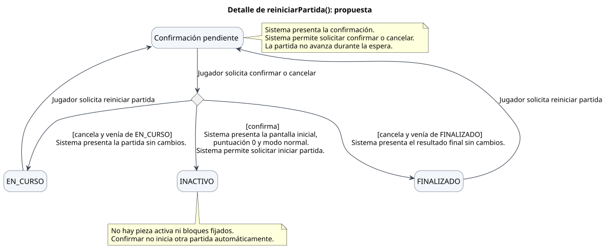

# Cómo cambiaría los diagramas

[Volver al README](../README.md) · [Ver el análisis](analisis.md)

He preparado estos dos diagramas para explicar mejor los cambios que propongo sobre los estados y el reinicio. Mantengo los tres estados del ejemplo y aclaro qué ocurre al confirmar o cancelar.

## Estados del sistema

[Ver el archivo PlantUML](../modelosUML/estados.puml)

Añadiría el paso de `EN_CURSO` a `INACTIVO` cuando se confirma el reinicio. También dejaría claro que llegar a `FINALIZADO` significa haber terminado la partida, no cerrar la aplicación. Si se cancela el reinicio, se sigue en el estado en el que se estaba.

## Reiniciar una partida

- **Actor:** Jugador.
- **Antes de empezar:** la partida está en curso o ha terminado y no se está esperando otra confirmación.
- **Cómo empieza:** el jugador solicita reiniciar.

El flujo principal quedaría así:

1. El sistema presenta una confirmación y permite confirmar o cancelar.
2. El jugador solicita confirmar.
3. El sistema presenta la pantalla inicial, sin pieza activa ni bloques fijados, con puntuación cero y velocidad normal.
4. El sistema permite solicitar iniciar una partida. El estado queda en `INACTIVO`.

Si el jugador cancela, el sistema vuelve a presentar la partida o el resultado final sin cambios. Cancelar desde `FINALIZADO` no permite seguir jugando una partida que ya se ha perdido.

Mientras se espera la respuesta, la partida no avanza y no se puede mover, girar ni cambiar la velocidad. Si se cancela durante una partida, la caída continúa con la velocidad que tenía antes. Se espera un intervalo completo antes del siguiente descenso, sin recuperar los que no se hicieron durante la confirmación. Lo plantearía así para que no se pueda perder mientras se responde al mensaje.

[Ver el archivo PlantUML](../modelosUML/reiniciarPartida.puml)

## Ejemplos para comprobarlo

| Situación | Qué pide el jugador | Qué debería pasar |
|---|---|---|
| Partida en curso o terminada | Reiniciar y confirmar | Vuelve al inicio, sin pieza ni bloques, con puntuación 0 y velocidad normal. Puede pedir iniciar otra partida. |
| Partida en curso | Reiniciar y cancelar | Conserva la pieza, el tablero, los puntos y la velocidad, y puede seguir jugando. |
| Partida terminada | Reiniciar y cancelar | Se siguen mostrando el tablero y la puntuación final. La partida no se reanuda. |
| Se está esperando la confirmación | No responder todavía | La pieza no baja y la partida no cambia. |

Los diagramas están guardados en SVG y sus archivos PlantUML están en la carpeta `modelosUML`.
