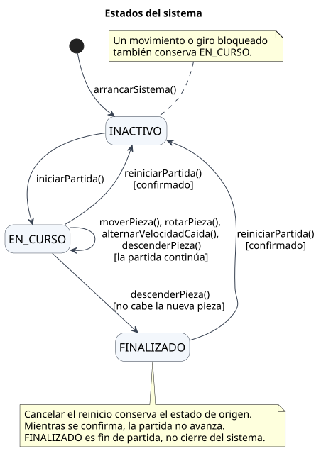
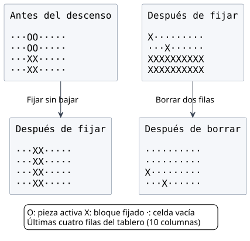

# Propuestas y ejemplos

[Volver al README](../README.md) · [Ver el análisis](analisis.md)

[Estados del sistema](#estados-del-sistema) · [Reiniciar una partida](#reiniciar-una-partida) · [Ejemplos del descenso](#ejemplos-del-descenso)

## Estados del sistema

[Abrir diagrama](../images/estados.svg) · [Ver PlantUML](../modelosUML/estados.puml)

El cambio principal es añadir el paso de `EN_CURSO` a `INACTIVO` cuando se confirma el reinicio. Si se cancela, se conserva el estado anterior. Las etiquetas indican qué caso de uso lleva a cada estado.

## Reiniciar una partida

- **Actor:** Jugador.
- **Antes de empezar:** la partida está en curso o ha terminado y no se está esperando otra confirmación.
- **Cómo empieza:** el jugador solicita reiniciar.

El flujo principal quedaría así:

1. El sistema presenta una confirmación y permite confirmar o cancelar.
2. El jugador solicita confirmar.
3. El sistema presenta la pantalla inicial, sin pieza activa ni bloques fijados, con puntuación cero y velocidad normal.
4. El sistema permite solicitar iniciar una partida. El estado queda en `INACTIVO`.

Si el jugador cancela, el sistema vuelve a presentar la partida o el resultado final sin cambios. Cancelar desde `FINALIZADO` no permite seguir jugando una partida que ya se ha perdido.

Mientras se espera la respuesta, la partida no avanza y no se puede mover, girar ni cambiar la velocidad. Si se cancela desde `EN_CURSO`, la partida continúa con la velocidad que tenía antes y sin descensos acumulados durante la espera. Así el jugador no puede perder mientras responde al mensaje.

[Abrir diagrama](../images/reiniciarPartida.svg) · [Ver PlantUML](../modelosUML/reiniciarPartida.puml)

### Ejemplos para comprobar el reinicio

| Situación | Qué pide el jugador | Qué debería pasar |
|---|---|---|
| Partida en curso o terminada | Reiniciar y confirmar | Vuelve al inicio, sin pieza ni bloques, con puntuación 0 y velocidad normal. Puede pedir iniciar otra partida. |
| Partida en curso | Reiniciar y cancelar | Conserva la pieza, el tablero, los puntos y la velocidad, y puede seguir jugando. |
| Partida terminada | Reiniciar y cancelar | Se siguen mostrando el tablero y la puntuación final. La partida no se reanuda. |
| Se está esperando la confirmación | No responder todavía | La pieza no baja y la partida no cambia. |

## Ejemplos del descenso

Estos dos ejemplos concretan las aclaraciones del [análisis](analisis.md). Se muestran solo las cuatro filas inferiores de un tablero de 10 × 20; el resto está vacío.

[Abrir imagen](../images/ejemplosDescenso.svg) · [Ver PlantUML](../modelosUML/ejemplosDescenso.puml)

- **Pieza ya apoyada:** al recibir la solicitud de descenso, la pieza cuadrada no puede bajar. Se fija en las mismas celdas. Como no se completa ninguna fila, la puntuación no cambia.
- **Dos filas completas:** después de fijar una pieza, las dos filas inferiores están llenas. Se eliminan ambas y los bloques de arriba bajan dos filas. Los puntos se calculan según la regla acordada para borrar dos filas en un mismo descenso.

Las imágenes terminan antes de que aparezca la siguiente pieza. En ambos ejemplos hay espacio para presentarla en la parte superior del tablero.
