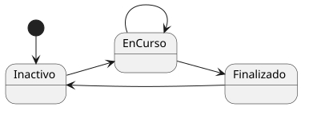

# Corrección: `DiagramaDeContexto000` (Estados del sistema)

## 1. Clasificación del hallazgo

- **Flanco:** Incoherencia entre artefactos.

## 2. Descripción de la incoherencia

En el diagrama original, el estado `Finalizado` tiene dos salidas:

1. `Finalizado -> Inactivo`
2. `Finalizado -> [*]`

Sin embargo, al compararlo con el resto del modelo, no existe ningún caso de uso para cerrar o salir del sistema, y ninguno de los dos actores (`Jugador` ni `Tiempo`) dispara la salida hacia el estado final `[*]`.

## 3. Justificación

Una transición sin evento hacia el estado final se ejecuta de forma automática en cuanto el sistema entra en ese estado. Como `Finalizado` no realiza ninguna actividad interna que esperar, el sistema se cerraría de inmediato al terminar la partida, haciendo imposible que el jugador llegue a ejecutar `reiniciarPartida()` para volver a `Inactivo`.

Además, en sistemas que funcionan en un ciclo continuo y cuyo cierre queda fuera del alcance del software, no es obligatorio incluir un estado final.

## 4. Corrección aplicada

Se elimina la transición `Finalizado -> [*]` para que el ciclo de vida del sistema sea coherente con los casos de uso definidos y con los diagramas de ambos actores.

### Comparativa visual

**Diagrama original (repositorio)**

**Diagrama corregido**

