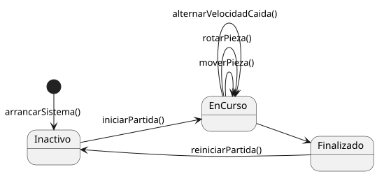

# Corrección: `DiagramaDeContexto001-ActorJugador`

## 1. Clasificación del hallazgo

- **Flanco:** Incoherencia entre artefactos.

## 2. Descripción de la incoherencia

En el diagrama original del actor `Jugador` aparece la transición `EnCurso --> Inactivo : reiniciarPartida()`. Sin embargo, el diagrama general del sistema (`DiagramaDeContexto000`) no contempla volver a `Inactivo` desde `EnCurso`; el único retorno permitido hacia `Inactivo` ocurre desde `Finalizado`.

## 3. Justificación

El diagrama general de estados establece las transiciones válidas del sistema. Los diagramas de cada actor son vistas sobre ese mismo mapa para mostrar qué transiciones dispara cada uno, por lo que no pueden introducir caminos que no existen en el diagrama principal. Al no estar contemplado el reinicio a mitad de partida en el diagrama general, ese caso no forma parte del alcance modelado.

## 4. Corrección aplicada

Se elimina `EnCurso --> Inactivo : reiniciarPartida()`, manteniendo `reiniciarPartida()` únicamente en la transición `Finalizado --> Inactivo`.

### Comparativa visual

**Diagrama original (repositorio)**

**Diagrama corregido**

