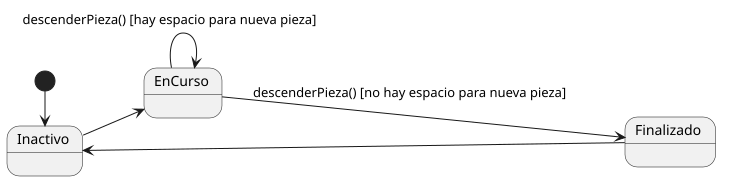

# Corrección: `DiagramaDeContexto001-ActorTiempo`

## 1. Clasificación del hallazgo

- **Flanco:** Incoherencia interna del diagrama y de nomenclatura frente a los casos de uso.

## 2. Descripción de la incoherencia

En el diagrama original del actor `Tiempo`, desde el estado `EnCurso` salen dos transiciones disparadas por el mismo evento:

1. Una que vuelve a `EnCurso` con `descenderPieza()`, sin indicar ninguna condición.
2. Otra que va a `Finalizado` con `descenderPieza [no hay espacio para nueva pieza]`, con condición pero sin los paréntesis del nombre del caso de uso.

## 3. Justificación

Una transición sin condición se considera siempre válida. Cuando salen dos caminos del mismo estado con el mismo evento, sus condiciones deben ser excluyentes para que el sistema sepa siempre qué camino tomar.

Al no indicar la condición contraria en la vuelta a `EnCurso`, en el momento en que no haya espacio para una nueva pieza ambas transiciones quedarían habilitadas al mismo tiempo, provocando ambigüedad. Además, omitir los paréntesis en una de ellas rompe la uniformidad con el nombre del caso de uso `descenderPieza()`.

## 4. Corrección aplicada

1. Se añade la condición `[hay espacio para nueva pieza]` en la transición que vuelve a `EnCurso`.
2. Se unifica el nombre del evento como `descenderPieza()` en ambas transiciones.

### Comparativa visual

**Diagrama original (repositorio)**

**Diagrama corregido**

