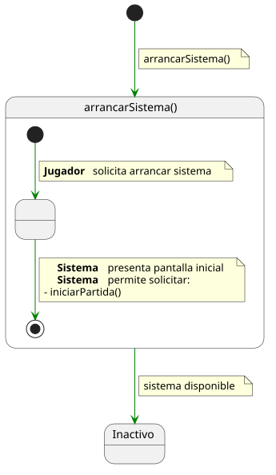

# Corrección: `arrancarSistema`

## 1. Clasificación del hallazgo

- **Flanco:** Incoherencia entre artefactos e inconsistencia interna del diagrama.

## 2. Descripción de la incoherencia

En el diagrama original de `arrancarSistema`, el bloque del caso de uso aparece sin ninguna transición de entrada, a diferencia del resto de diagramas de detalle y del diagrama de contexto del jugador, donde este caso de uso parte explícitamente del estado inicial `[*]`.

## 3. Justificación

Sin el punto inicial `[*]` y su transición entrante, el diagrama no indica dónde comienza la ejecución y el caso de uso queda aislado como un bloque inalcanzable. Además, todos los demás diagramas de detalle muestran el origen, el disparo del caso de uso y el destino reflejando el diagrama de contexto; omitir la entrada aquí rompe esa consistencia.

## 4. Corrección aplicada

Se añade el estado inicial `[*]` y la transición de entrada hacia `arrancarSistema` etiquetada con `arrancarSistema()`, alineando el diagrama con `DiagramaDeContexto001-ActorJugador` y con el resto de detalles de casos de uso.

### Comparativa visual

**Diagrama original (repositorio)**

**Diagrama corregido**

