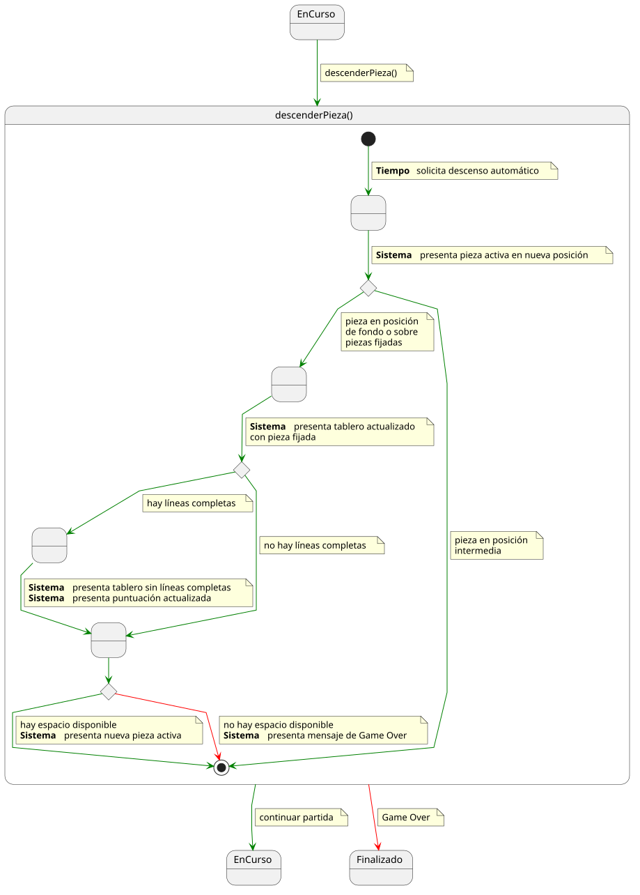

# Corrección: `descenderPieza`

## 1. Clasificación del hallazgo

- **Flanco:** Decisión discutible.

## 2. Qué se decidió en el original

En el diagrama original de `descenderPieza`, después de fijar una pieza (`FijandoPieza`), el flujo pasa siempre de forma obligatoria por `EliminandoLineas`, indicando que el sistema presenta el tablero sin líneas completas y la puntuación actualizada.

## 3. Propuesta y justificación

En la mayoría de los turnos de una partida de Tetris, fijar una pieza **no completa ninguna línea**, por lo que no se elimina nada ni cambia la puntuación. Dar por hecho ese paso en todos los casos hace que el diagrama no refleje el comportamiento real del juego.

Se propone introducir una comprobación tras fijar la pieza para distinguir si hay líneas completas o no antes de pasar a generar la siguiente pieza.

## 4. Corrección aplicada

Se añade una decisión tras `FijandoPieza` que solo pasa por `EliminandoLineas` si hay líneas completas; en caso contrario, avanza directamente a `GenerandoNuevaPieza`.

### Comparativa visual

**Diagrama original (repositorio)**

**Diagrama corregido**

