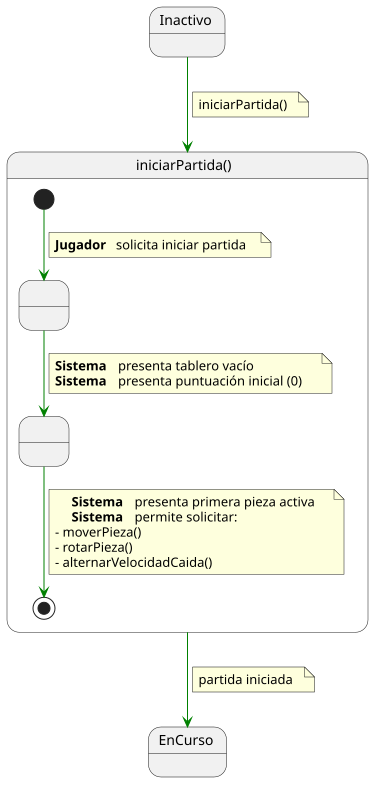

# Corrección: `iniciarPartida`

## 1. Clasificación del hallazgo

- **Flanco:** Incoherencia entre artefactos.

## 2. Descripción de la incoherencia

En el listado de operaciones que el sistema permite solicitar al pasar al estado `EnCurso` se detectan dos errores respecto al resto del modelo:

1. **Caso de uso inexistente (`acelerarCaida()`):** Se menciona `acelerarCaida()`, cuando en el diagrama de casos de uso y en el diagrama de contexto del jugador el caso de uso se llama `alternarVelocidadCaida()`.
2. **Operación no permitida en `EnCurso` (`reiniciarPartida()`):** Se ofrece `reiniciarPartida()` al entrar en `EnCurso`, cuando el reinicio solo está permitido desde `Finalizado`.

## 3. Justificación

El detalle de un caso de uso debe referenciar exactamente los mismos nombres de casos de uso definidos en el modelo general y únicamente las acciones válidas en el estado al que transiciona el sistema. Incluir un nombre antiguo (`acelerarCaida()`) y una operación fuera de lugar (`reiniciarPartida()`) rompe la coherencia con los diagramas de casos de uso y de contexto.

## 4. Corrección aplicada

1. Se sustituye `acelerarCaida()` por `alternarVelocidadCaida()`.
2. Se elimina `reiniciarPartida()` de la lista de solicitudes permitidas al entrar en `EnCurso`.

### Comparativa visual

**Diagrama original (repositorio)**

**Diagrama corregido**

