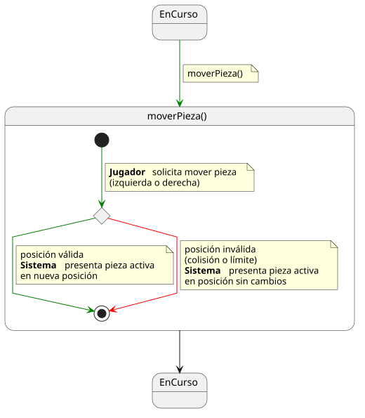

# Corrección: `moverPieza`

## 1. Clasificación del hallazgo

- **Flanco:** Incoherencia interna del diagrama.

## 2. Descripción de la incoherencia

En el diagrama original de `moverPieza`, tanto el movimiento válido como el inválido terminan dentro del caso de uso en el mismo punto final `[*]`, pero fuera de él salen dos flechas distintas (`movimiento realizado` y `movimiento bloqueado`) apuntando al mismo estado de retorno.

## 3. Justificación

Una vez que las dos ramas internas ya se resolvieron dentro del caso de uso y convergen en el mismo punto final, sacar dos flechas distintas hacia el mismo estado destino resulta redundante y genera ambigüedad innecesaria sobre qué transición debe tomarse al salir.

## 4. Corrección aplicada

Se reemplazan las dos flechas de salida por una única transición simple hacia `EnCurso`.

### Comparativa visual

**Diagrama original (repositorio)**

**Diagrama corregido**

