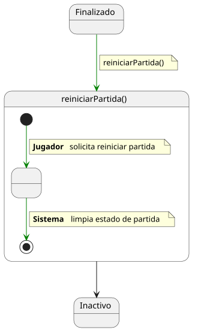

# Corrección: `reiniciarPartida`

## 1. Clasificación del hallazgo

- **Flanco:** Incoherencia entre artefactos.

## 2. Descripción de la incoherencia

En el diagrama original de `reiniciarPartida` se detectan dos problemas respecto a los diagramas de contexto:

1. **Entrada y salida desde `EnCurso`:** El diagrama contempla reiniciar la partida mientras está `EnCurso` y volver a ese estado si se cancela, cuando en el diagrama general de estados el reinicio solo es posible desde `Finalizado`.
2. **Confirmación y retorno a `Finalizado`:** Incluye un flujo de confirmación con una rama de cancelación que devuelve al sistema al estado `Finalizado`, creando un bucle que no existe en los diagramas de contexto.

## 3. Justificación

Al no estar permitido reiniciar a mitad de una partida, las transiciones ligadas a `EnCurso` no forman parte del alcance del sistema.

Por otro lado, pedir confirmación solo tiene sentido cuando se interrumpe una partida activa para evitar perder el progreso. Una vez que el juego ya está en `Finalizado`, no hay progreso que proteger; mantener esa confirmación añade pasos innecesarios e introduce una vuelta a `Finalizado` que contradice el diagrama de contexto.

## 4. Corrección aplicada

1. Se eliminan la entrada desde `EnCurso` y su salida correspondiente.
2. Se elimina el diálogo de confirmación y la rama de cancelación hacia `Finalizado`, dejando un flujo directo en el que el sistema limpia el estado y pasa a `Inactivo`.

### Comparativa visual

**Diagrama original (repositorio)**

**Diagrama corregido**

