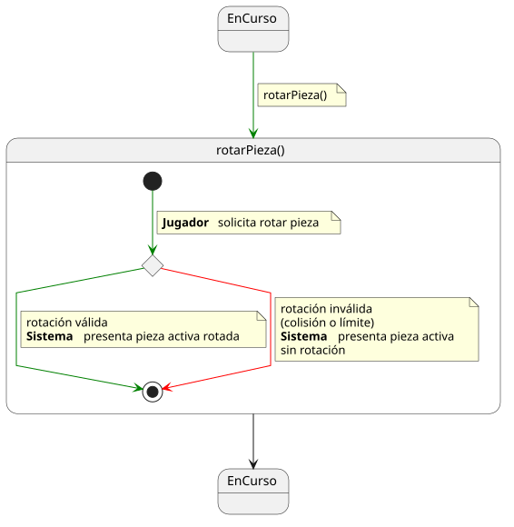

# Corrección: `rotarPieza`

## 1. Clasificación del hallazgo

- **Flanco:** Incoherencia entre artefactos e inconsistencia interna del diagrama.

## 2. Descripción de la incoherencia

En el diagrama original de `rotarPieza`, tanto la rotación válida como la inválida terminan dentro del caso de uso en el mismo punto final `[*]`, pero fuera de él salen dos flechas distintas (`rotación realizada` y `rotación bloqueada`) apuntando al mismo estado de retorno.

## 3. Justificación

Mantener nombres distintos para un mismo estado rompe la trazabilidad entre los diagramas de contexto y el detalle de los casos de uso.

Por otro lado, una vez que las dos ramas internas ya se resolvieron dentro del caso de uso y convergen en el mismo punto final, sacar dos flechas distintas hacia el mismo estado destino resulta redundante y genera ambigüedad innecesaria sobre qué transición debe tomarse al salir.

## 4. Corrección aplicada

1. Se renombra el estado `EN_CURSO` a `EnCurso` para unificar la nomenclatura con los diagramas de contexto.
2. Se reemplazan las dos flechas de salida por una única transición simple hacia `EnCurso`.

### Comparativa visual

**Diagrama original (repositorio)**

**Diagrama corregido**

