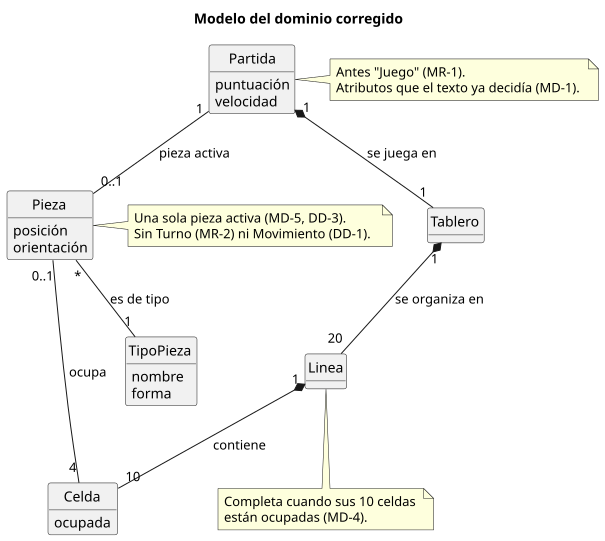

# Correcciones

[README](../README.md) · [Hallazgos](hallazgos.md)

## Modelo del dominio corregido

[Ver código PlantUML](../modelosUML/modeloDominio.puml)

| Cambio | Hallazgo |
|-|-|
| `Juego` pasa a llamarse `Partida` | MR-1 |
| `Partida` tiene `puntuación` y `velocidad` | MD-1 |
| Todas las relaciones tienen multiplicidad y ninguna lleva flecha | MD-2, DD-4 |
| Una sola pieza activa (`0..1`), con asociación normal | MD-5, DD-3 |
| Se eliminan `Turno` y `Movimiento` | MR-2, DD-1 |
| `Celda` tiene un solo dueño: Tablero ◆ Línea ◆ Celda | DD-2 |
| La línea está completa cuando sus 10 celdas están ocupadas | MD-4 |